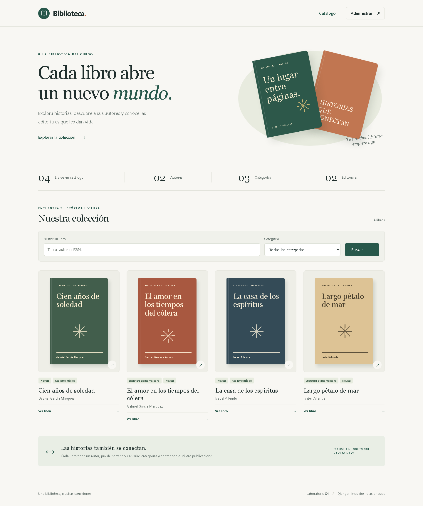

# Semana 4 · Relación de modelos en Django

Proyecto de biblioteca desarrollado desde cero para el laboratorio 4 de
**Desarrollo de Aplicaciones Empresariales**. Incluye el catálogo, el
administrador y las evidencias técnicas de las relaciones entre modelos.



## Qué incluye

- `Author`, `AuthorProfile`, `Book`, `Category`, `Publisher` y `Publication`.
- `ForeignKey`, `OneToOneField`, `ManyToManyField` y `through`.
- Dos migraciones que registran el cambio de `CASCADE` a `PROTECT`.
- Administrador con perfil de autor y publicaciones como formularios integrados.
- Imágenes de portada y de autor con Pillow y archivos de medios.
- Catálogo adaptable a móviles, búsqueda, categorías y paginación.
- Detalle con biografía, categorías, editoriales, fechas y ediciones.
- Datos de ejemplo, consultas reproducibles y comparación de borrado.
- 29 pruebas automatizadas y documentación en español.

El código, sus identificadores y comentarios están en inglés. La interfaz,
los datos de lectura y las explicaciones están en español.

## 1. Preparar el entorno en Windows

Requisito: **Python 3.12 o superior**. Se verificó con Python 3.14.7,
Django 5.2.17 y SQLite. La interfaz se construye con plantillas de Django y CSS.

Abre PowerShell en la raíz del repositorio:

```powershell
Set-Location ".\Semana 4"
py -m venv .venv
.\.venv\Scripts\python.exe -m pip install -r requirements.txt
```

Los comandos usan directamente el Python del entorno virtual, por lo que
funcionan sin activar `Activate.ps1`.

### Configurar la clave del proyecto

En la primera instalación:

```powershell
Copy-Item .env.example .env
.\.venv\Scripts\python.exe -c "import secrets; print(secrets.token_urlsafe(50))"
```

Copia la clave generada en el valor `DJANGO_SECRET_KEY` del archivo `.env`:

```dotenv
DJANGO_SECRET_KEY=pega_aqui_la_clave_generada
DJANGO_DEBUG=True
DJANGO_ALLOWED_HOSTS=localhost,127.0.0.1,[::1]
```

`python-dotenv` carga ese archivo. Las variables de entorno ya definidas tienen
prioridad. `.env`, `.venv`, la base SQLite y las imágenes subidas están excluidos
de Git. Si el entorno ya está preparado, conserva tu `.env` existente.

## 2. Crear la base y el administrador

```powershell
.\.venv\Scripts\python.exe manage.py migrate
.\.venv\Scripts\python.exe manage.py createsuperuser
```

Elige tu usuario y contraseña en la consola. El proyecto no incluye cuentas
administrativas predefinidas.

## 3. Cargar los libros

El paso 8 del laboratorio pide cargar los datos desde el administrador. La
[guía del laboratorio](docs/LAB_GUIDE.md#8-cargar-datos-desde-el-administrador)
contiene el orden de carga y todas las tablas de datos.

Para disponer del conjunto de ejemplo inmediatamente:

```powershell
.\.venv\Scripts\python.exe manage.py seed_library
```

En una base nueva crea:

| Registro | Cantidad |
|---|---:|
| Autores | 2 |
| Perfiles | 2 |
| Libros | 4 |
| Categorías | 3 |
| Editoriales | 2 |
| Publicaciones | 5 |

Se puede ejecutar de nuevo: reutiliza los registros y conserva sus campos
editados. Completa las relaciones de ejemplo que falten. Las editoriales,
fechas y ediciones son datos didácticos.

## 4. Iniciar la aplicación

```powershell
.\.venv\Scripts\python.exe manage.py runserver
```

- **Catálogo:** <http://127.0.0.1:8000/>
- **Administrador:** <http://127.0.0.1:8000/admin/>
- **Detalle de ejemplo:** <http://127.0.0.1:8000/books/1/>, en una base nueva
  cargada con `seed_library`. También puedes abrir cualquier libro del catálogo.

Detén el servidor con `Ctrl+C`.

## 5. Consultar y comprobar las relaciones

Desde otra terminal situada en `Semana 4`:

```powershell
$env:PYTHONUTF8 = "1"
.\.venv\Scripts\python.exe manage.py inspect_relations
.\.venv\Scripts\python.exe manage.py compare_deletions
.\.venv\Scripts\python.exe manage.py shell
```

- `inspect_relations` imprime consultas reales, sus resultados y las tablas.
- `compare_deletions` ejecuta borrados con los modelos históricos de las dos
  migraciones y revierte cada experimento con una transacción.
- `shell` permite escribir las consultas manualmente, como solicita la guía.

La política activa de `Book.author` es **`PROTECT`**. La comparación histórica
reproduce `CASCADE` sin cambiar esa configuración activa.

## 6. Verificar el proyecto

```powershell
.\.venv\Scripts\python.exe manage.py check
.\.venv\Scripts\python.exe manage.py makemigrations --check --dry-run
.\.venv\Scripts\python.exe manage.py test library --verbosity 2
```

Las pruebas usan una base temporal e incluyen integridad de relaciones,
borrados, restricciones, búsquedas, vistas, administración e imágenes.

Herramientas opcionales para revisar PEP 8 y generar capturas:

```powershell
.\.venv\Scripts\python.exe -m pip install -r requirements-dev.txt
.\.venv\Scripts\python.exe -m ruff check .
.\.venv\Scripts\python.exe -m playwright install chromium
```

Consulta [las instrucciones de capturas](docs/evidence/README.md).

## Estructura

```text
Semana 4/
├── config/                       # Project settings and root URLs
├── library/
│   ├── management/commands/
│   │   ├── seed_library.py
│   │   ├── inspect_relations.py
│   │   └── compare_deletions.py
│   ├── migrations/
│   │   ├── 0001_initial.py
│   │   └── 0002_protect_book_author.py
│   ├── static/library/css/styles.css
│   ├── templates/library/
│   │   ├── book_list.html
│   │   └── book_detail.html
│   ├── admin.py
│   ├── forms.py
│   ├── models.py
│   ├── tests.py
│   ├── urls.py
│   └── views.py
├── templates/base.html
├── docs/
│   ├── LAB_GUIDE.md
│   ├── MODEL_DIAGRAM.md
│   ├── QUERY_RESULTS.md
│   ├── DELIVERY_EVIDENCE.md
│   └── evidence/
├── .env.example
├── .gitignore
├── manage.py
├── pyproject.toml
├── requirements.txt
└── requirements-dev.txt
```

`db.sqlite3`, `.env`, `.venv/` y `media/` se generan localmente.

## Documentación para estudiar y entregar

1. [Guía paso a paso del laboratorio](docs/LAB_GUIDE.md).
2. [Diagrama de modelos y decisiones](docs/MODEL_DIAGRAM.md).
3. [Consultas y resultados registrados](docs/QUERY_RESULTS.md).
4. [Formato del entregable y evidencias](docs/DELIVERY_EVIDENCE.md).

El entregable incluye espacios para los integrantes y las capturas personales
del administrador, la consola y la estructura en el editor.
