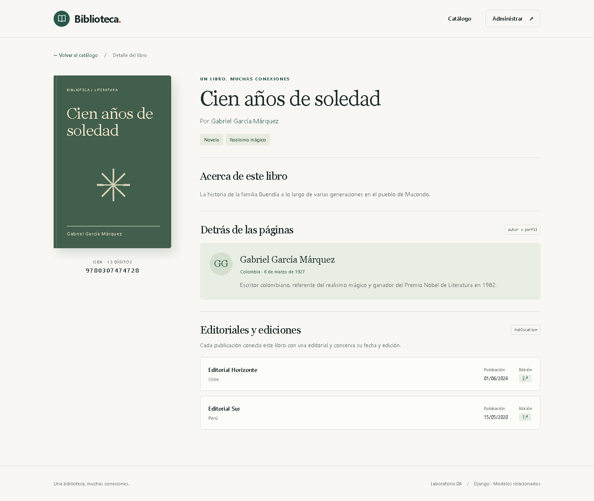

# Entregable · Laboratorio 4

## Datos generales

- **Curso:** Desarrollo de Aplicaciones Empresariales.
- **Tema:** Relación de modelos en Django.
- **Sección:** 4-C24-A.
- **Docente:** Michael Montgomery Rosell.
- **Equipo:** [Completar].
- **Integrantes:** [Completar nombres completos].
- **Fecha de entrega:** [Completar].
- **Repositorio de GitHub:** [Completar URL del repositorio del equipo].
- **Commit de entrega:** [Completar después de publicar].

Este documento contiene la descripción técnica y resultados verificados.
Completa la autoría y las evidencias personales antes de presentarlo.

## Objetivo

Implementar una biblioteca con relaciones uno a muchos, uno a uno y muchos
a muchos, incluyendo un modelo intermedio con atributos propios; consultar
las relaciones en ambos sentidos y comparar el efecto de las políticas de
borrado `CASCADE` y `PROTECT`.

## Distribución del trabajo

Registra las actividades efectivamente realizadas por cada integrante.

| Nombre del alumno | Actividad realizada | Archivos o evidencia |
|---|---|---|
| [Completar] | [Completar] | [Completar] |
| [Completar] | [Completar] | [Completar] |
| [Completar] | [Completar] | [Completar] |

## Desarrollo 1. Modelos y relaciones

- **Nombre del alumno:** [Completar].
- **Título del desarrollo:** Configuración de las relaciones de la biblioteca.
- **Captura del resultado:** [Insertar administrador y estructura en VS Code].
- **Código:** [library/models.py](../library/models.py),
  [migración inicial](../library/migrations/0001_initial.py).
- **Diagrama:** [MODEL_DIAGRAM.md](MODEL_DIAGRAM.md).

**Explicación:** `Book.author` utiliza una clave foránea porque varios libros
pueden referenciar al mismo autor. `AuthorProfile.author` es uno a uno para
mantener un único perfil por autor. Las categorías utilizan muchos a muchos
porque un libro puede tener más de una clasificación.

**Casos de prueba:** consultar en ambos sentidos; intentar crear un segundo
perfil para el mismo autor; asignar dos categorías al mismo libro y comprobar
que se obtiene desde ambas. Los casos automáticos están en `RelationshipTests`.

## Desarrollo 2. Publicaciones con datos propios

- **Nombre del alumno:** [Completar].
- **Título del desarrollo:** Relación libro–editorial mediante `Publication`.
- **Captura del resultado:** [Insertar formulario del administrador con dos publicaciones].
- **Código:** `Book.publishers` y `Publication` en
  [models.py](../library/models.py); `PublicationInline` en
  [admin.py](../library/admin.py).

**Explicación:** `through="Publication"` conecta explícitamente el muchos a
muchos. Cada registro guarda libro, editorial, fecha y edición. La combinación
libro–editorial–edición es única y la edición debe ser mayor o igual a uno.

**Casos de prueba:** consultar las publicaciones desde el libro y la editorial;
intentar duplicar una edición; comprobar que otra edición para la misma pareja
sí puede guardarse y que la edición cero se rechaza.

## Desarrollo 3. Consultas y políticas de borrado

- **Nombre del alumno:** [Completar].
- **Título del desarrollo:** Recorridos del ORM y comparación de `on_delete`.
- **Captura del resultado:** [Insertar consola con consultas y ambos borrados].
- **Código:** [inspect_relations.py](../library/management/commands/inspect_relations.py),
  [compare_deletions.py](../library/management/commands/compare_deletions.py),
  [cambio a PROTECT](../library/migrations/0002_protect_book_author.py).
- **Resultados registrados:** [QUERY_RESULTS.md](QUERY_RESULTS.md).

**Explicación:** el acceso directo obtiene el objeto relacionado; el
`related_name` permite consultar desde el lado inverso. Los filtros con `__`
atraviesan relaciones. `CASCADE` eliminó los libros y dependencias del autor;
`PROTECT` lanzó `ProtectedError` y conservó todos los registros.

**Casos de prueba:** borrar un autor con libros en las dos etapas; borrar
un autor sin libros y comprobar que desaparece su perfil; intentar borrar
una editorial con publicaciones. Las transacciones de los experimentos
permitieron conservar la base de ejemplo.

## Desarrollo 4. Relaciones en la vista y la plantilla

- **Nombre del alumno:** [Completar].
- **Título del desarrollo:** Catálogo y detalle del libro.
- **Código:** [views.py](../library/views.py),
  [book_detail.html](../library/templates/library/book_detail.html).
- **Capturas del resultado:**



[Ver catálogo de escritorio](evidence/catalog-desktop.png) ·
[Ver catálogo móvil](evidence/catalog-mobile.png)

**Explicación:** el detalle muestra las categorías y todas las publicaciones,
cada una con editorial, fecha y edición. También muestra el nombre del autor,
su país, fecha de nacimiento y biografía. La vista usa `select_related` y
`prefetch_related` y resuelve el detalle anónimo en tres consultas.

**Casos de prueba:** abrir un libro con varias relaciones; abrir un libro
sin perfil ni publicaciones; buscar por autor y filtrar por categoría;
consultar un identificador inexistente y comprobar HTTP 404.

Las capturas incluidas se generaron con la carga automática de ejemplo.

## Resumen de validación

Se ejecutaron **29 pruebas automatizadas**, todas correctas, con una base de
prueba independiente. Incluyen el alta por el administrador de un libro con
imagen, categorías y publicación, y el alta de un autor con su perfil.

Para repetir la validación desde `Semana 4`:

```powershell
.\.venv\Scripts\python.exe manage.py check
.\.venv\Scripts\python.exe manage.py makemigrations --check --dry-run
.\.venv\Scripts\python.exe manage.py test library --verbosity 2
```

## Evidencias personales por completar

- [ ] Nombres, responsabilidades reales y fecha de entrega.
- [ ] Captura de la estructura `Semana 4` abierta en Visual Studio Code.
- [ ] Capturas del administrador con 2 autores, 4 libros, 3 categorías y 2 editoriales.
- [ ] Evidencia de carga manual y un libro en dos categorías.
- [ ] Captura de un perfil de autor y de las publicaciones con fecha y edición.
- [ ] Captura de las migraciones aplicadas y las siete tablas de la aplicación.
- [ ] Capturas de consultas de ida, vuelta y filtros con `__` en la consola.
- [ ] Capturas de `CASCADE` y `PROTECT`, con explicación del resultado.
- [ ] Captura de ejecución de las pruebas en el equipo del estudiante.
- [ ] URL del repositorio, commit publicado y envío al campus virtual.

## Correspondencia con la rúbrica

| Criterio | Puntaje máximo | Evidencia preparada |
|---|---:|---|
| Configura las tres clases de relaciones | 5 | Modelos, pruebas, diagrama y justificación. |
| Modelo intermedio con atributos propios | 5 | `Publication`, admin integrado, fecha y edición visibles, consultas desde ambos lados. |
| Consulta en ambos sentidos y comprueba `on_delete` | 5 | Registro de consultas, dos migraciones, borrados reales y comparación reproducible. |
| Repositorio, modelo relacional y observaciones | 5 | Código, documentación, diagrama y capturas de la aplicación; completar publicación y evidencias personales. |

## Conclusiones

1. Las relaciones deben representar la cardinalidad del caso: una clave
   foránea admite varios libros por autor, el uno a uno limita el perfil
   y el muchos a muchos permite compartir categorías y editoriales.
2. El modelo intermedio almacena atributos de la relación. Fecha y edición
   describen una publicación concreta y se pueden consultar desde ambos lados.
3. La política `on_delete` determina cómo responde el ORM ante un borrado.
   `CASCADE` elimina dependencias y `PROTECT` conserva el catálogo bloqueando
   autores referenciados por libros.
4. La plantilla confirma que las relaciones llegan a la interfaz; las pruebas
   y consultas registradas permiten comprobar tanto la integridad como los
   casos opcionales y los errores esperados.
