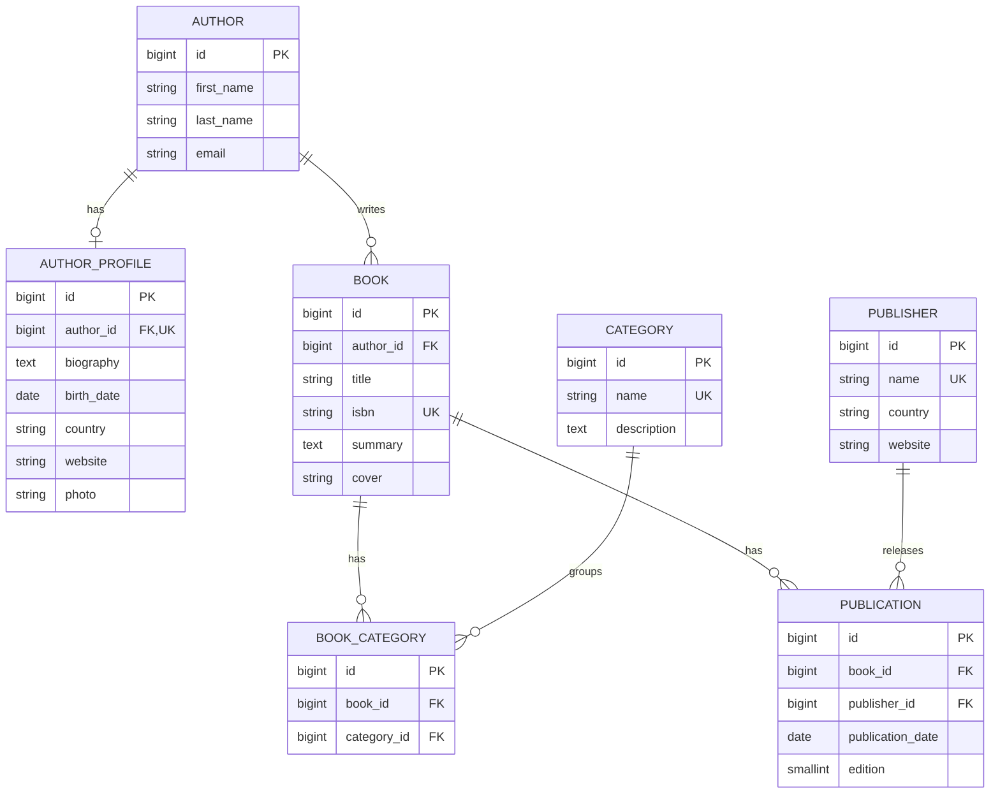

# Diagrama de modelos y decisiones

## Esquema relacional

GitHub y la vista previa de Markdown compatible con Mermaid muestran este
diagrama. `BOOK_CATEGORY` representa la tabla intermedia que Django crea
automáticamente.

## Por qué se eligió cada relación

| Relación | Campo Django | Justificación | Recorrido inverso |
|---|---|---|---|
| Libro → autor | `ForeignKey` | Cada libro tiene un autor en este caso; un autor puede escribir varios libros. | `author.books.all()` |
| Perfil → autor | `OneToOneField` | Cada autor puede tener como máximo un perfil. Se separan los datos biográficos del registro principal. | `author.profile` |
| Libro ↔ categoría | `ManyToManyField` | Un libro puede pertenecer a varias categorías; cada categoría agrupa varios libros. | `category.books.all()` |
| Libro ↔ editorial | `ManyToManyField(through="Publication")` | Una editorial publica varios libros y un libro puede tener publicaciones de distintas editoriales. La relación tiene fecha y edición propias. | `publisher.books.all()` |

El perfil es opcional: crear un `Author` no crea automáticamente un
`AuthorProfile`. El administrador permite agregarlo en el mismo formulario,
y la vista maneja el caso sin perfil.

El laboratorio considera un autor por libro. `isbn` es el identificador único
del registro `Book` y se valida como 13 dígitos; no se comprueba el dígito de
control. El conjunto de publicaciones es didáctico. Un catálogo bibliográfico
con ISBN por edición requeriría asociarlo a cada publicación o formato.

## Políticas de borrado finales

| Campo | `on_delete` | Efecto y motivo |
|---|---|---|
| `Book.author` | `PROTECT` | Impide eliminar un autor que aún tenga libros; conserva el catálogo. |
| `AuthorProfile.author` | `CASCADE` | Cuando se elimina un autor sin libros, se elimina su perfil dependiente. |
| `Publication.book` | `CASCADE` | Al borrar un libro, desaparecen sus publicaciones. |
| `Publication.publisher` | `PROTECT` | Una editorial con publicaciones no puede eliminarse hasta resolver esas referencias. |

Al eliminar una categoría se borran las filas de `library_book_categories`
que la referencian; los libros permanecen. Al eliminar un libro también
desaparecen sus enlaces con categorías, pero las categorías y editoriales
permanecen.

La migración `0001_initial` conserva `Book.author` con `CASCADE`. La migración
`0002_protect_book_author` documenta su cambio a `PROTECT`. `on_delete` es
comportamiento del ORM de Django; no equivale a configurar una cláusula SQL
`ON DELETE CASCADE` en la base de datos.

## Restricciones y campos propios

- `AuthorProfile.author_id` es único por la relación uno a uno.
- `Book.isbn`, `Category.name` y `Publisher.name` son únicos.
- `Publication` exige una combinación única de **libro + editorial + edición**.
- La edición debe ser al menos `1`, con validador y restricción en la base.
- `library_book_categories` impide repetir la misma pareja libro–categoría.
- Cada modelo declara `Meta` con ordenación y nombres, y un `__str__` legible.
- Las imágenes se guardan como archivos en `media/`; la base guarda sus rutas.

La misma editorial puede tener varias ediciones de un libro. Por ello,
`book.publishers.distinct()` evita repetir editoriales al recorrer el muchos
a muchos. Para mostrar fecha y edición se utiliza `book.publications.all()`.

## Tablas creadas por la aplicación

| Tabla | Origen |
|---|---|
| `library_author` | `Author` |
| `library_authorprofile` | `AuthorProfile` |
| `library_book` | `Book` |
| `library_category` | `Category` |
| `library_publisher` | `Publisher` |
| `library_book_categories` | Intermedia implícita del muchos a muchos |
| `library_publication` | Modelo intermedio explícito `Publication` |

`through="Publication"` hace que la relación editorial–libro utilice
`library_publication`. Django no crea una segunda tabla `library_book_publishers`.

## De la base a la plantilla

`BookDetailView` carga el autor y el perfil con
`select_related("author__profile")`, y las categorías y publicaciones con
`prefetch_related`. Cada publicación carga su editorial con `select_related`.
Así, el detalle anónimo completo se resuelve en **tres consultas**, incluso
cuando el libro tiene varias categorías y publicaciones. Una prueba verifica
esa cantidad.
